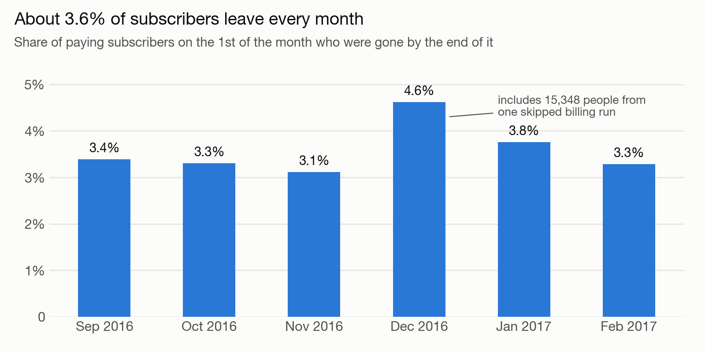
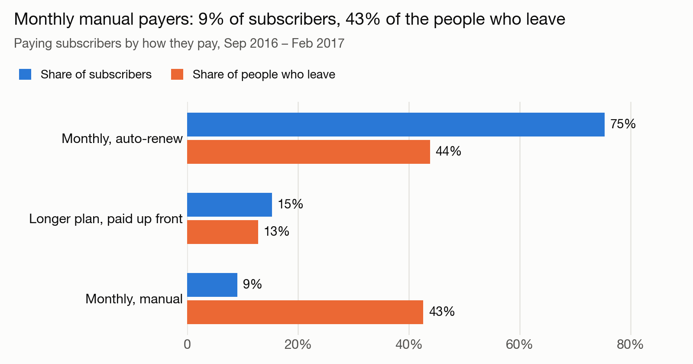
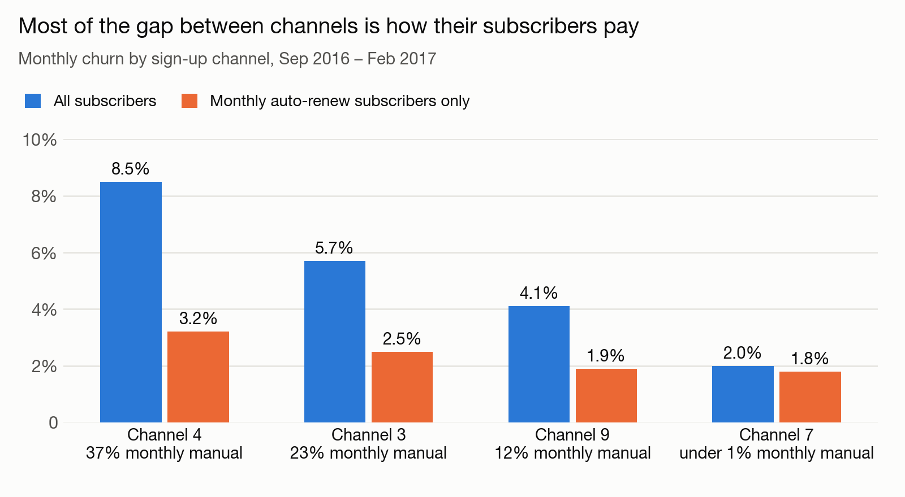
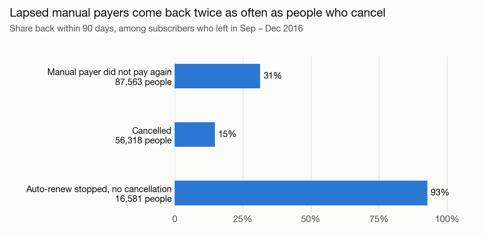

# Who is a subscription service losing?

Six business questions about subscriber churn, each answered with one SQL query on
23 million real billing rows.

**Skill on show: SQL.** Window functions, gaps-and-islands, a date spine, a join on
validity intervals, filtered aggregates, and checks that stop the build when the
numbers don't add up. The database is DuckDB. Python only runs the SQL files and
draws the charts.

**The answer in one line:** the service loses about 3.6% of its
subscribers a month, and 43% of the people who leave come from the
9% who pay month by month by hand.

## Business problem

KKBox is a music streaming service in Taiwan. In this data it has about 1.1 million
paying subscribers. The base is growing, but every month around 40,000 people stop
paying. The product team wants to know who they are and what is worth changing.

I split that into six questions:

1. How many paying subscribers are there each month, and is the base growing?
2. What share of subscribers leaves each month?
3. Do people on monthly plans leave more often than people on longer plans?
4. Auto-renew or manual renewal: where do we lose more?
5. Which sign-up channels bring subscribers who stay?
6. Of the people who leave, how many come back within 90 days?

## Data

Real billing data that KKBox released for the
[WSDM Cup 2018 churn challenge](https://www.kaggle.com/competitions/kkbox-churn-prediction-challenge)
on Kaggle. I use three of its files:

| File | One row is | Rows |
|---|---|---:|
| `transactions.csv` | one billing event for one user: a payment, a free trial or a cancellation | 21,547,746 |
| `transactions_v2.csv` | the same, for the most recent part of the history | 1,431,009 |
| `members_v3.csv` | one user, with the channel they signed up through | 6,769,473 |

- The history runs from January 2015 to March 2017. It is old, but plans, auto-renew
  and cancellations work the same way in any subscription business today.
- Prices are in New Taiwan dollars. The standard plan is 30 days for NT$149.
- User ids are hashed, and sign-up channels are published as codes ("channel 4"), so
  I can't name them.
- The files are not in this repo. Kaggle asks you to accept the competition rules
  before downloading them; [Run it yourself](#run-it-yourself) says where they go.

## Process

**1. Load.** [`sql/01_load.sql`](sql/01_load.sql) reads both transaction files into one
table. Of 22,978,755 rows it drops 1,804 with junk dates (1970-01-01 and the like) and
3,341 exact duplicates.

**2. Turn billing rows into subscriptions.** [`sql/02_subscriptions.sql`](sql/02_subscriptions.sql).
This is the one modelling step, and everything else rests on it.

Here is one real user. Every row is a payment of NT$149 for 30 days, made by hand:

| Paid on | Membership runs to | |
|---|---|---|
| 12 Jun 2016 | 12 Jul 2016 | |
| 13 Jul 2016 | 12 Aug 2016 | |
| 14 Aug 2016 | 13 Sep 2016 | |
| 16 Sep 2016 | 16 Oct 2016 | |
| 22 Dec 2016 | 21 Jan 2017 | 67 days after the membership ran out |
| 27 Jan 2017 | 26 Feb 2017 | |

The second, third and fourth payments came one, two and three days late. Then nothing
for 67 days.
That is two subscriptions: the first ran from 12 June to 16 October and ended in
churn, the second started on 22 December.

The rule is KKBox's own definition of churn. A subscription is an unbroken stretch of
membership. If the membership runs out and no new transaction arrives within 30 days,
the subscription has ended and the subscriber has churned. A later transaction starts
a new subscription.

In SQL this is a gaps-and-islands problem: compare each row with the one before it,
flag the rows that start a new stretch, and a running total of the flags numbers the
stretches.

```sql
WITH ordered AS (
    SELECT
        *,
        row_number()     OVER w AS seq,
        lag(expire_date) OVER w AS previous_expire_date
    FROM transactions
    WINDOW w AS (PARTITION BY user_id ORDER BY transaction_date, is_cancel, expire_date)
),
marked AS (
    SELECT
        *,
        CASE WHEN previous_expire_date IS NULL                     THEN 1   -- first ever
             WHEN transaction_date > previous_expire_date + 30     THEN 1   -- came back after a lapse
             ELSE 0 END AS starts_subscription
    FROM ordered
)
SELECT
    *,
    sum(starts_subscription) OVER (PARTITION BY user_id ORDER BY seq) AS subscription_number
FROM marked;
```

The result is 3,073,709 subscriptions for 2,425,986 users.

**3. One row per subscriber per month.** [`sql/03_subscriber_months.sql`](sql/03_subscriber_months.sql)
takes the 1st of each month and lists everyone with a paid subscription running that
day, the plan they were on, and whether the subscription ended during that month. All
six questions are counts over this one table.

I use the last six months with a known outcome, September 2016 to February 2017. March
2017 is the last month of data, so nobody who lapsed in March has had their 30 days yet.

**4. Check.** [`sql/checks.sql`](sql/checks.sql) holds three queries that must return
nothing: one row per subscriber per month, no overlapping subscriptions for one user,
and the months must add up (subscribers on the 1st + joined − left = subscribers on the
next 1st). They add up to the person in all six months.

**One caveat.** Billing data can't tell a missed charge from a decision to leave. In
this window it matters once: on 5 December 2016 the membership of 15,348 auto-renew
subscribers ran out with no cancellation, and 15,338 of them were charged again on
5 January, 31 days later and one day past the 30-day rule. I kept the rule as it is, so
they count as leaving in December and coming back in January. Where that changes a
number, I say so.

## Insights

### 1. How many paying subscribers are there each month, and is the base growing?

**It is growing slowly: 1,094,330 paying subscribers on 1 September 2016,
1,177,591 on 1 March 2017. That is +7.6% in six months.**

| 1st of the month | Paying subscribers | Change on previous month | Growth since Sep 2016 |
|---|---:|---:|---:|
| Sep 2016 | 1,094,330 |  | 0.0% |
| Oct 2016 | 1,104,791 | +10,461 | 1.0% |
| Nov 2016 | 1,114,428 | +9,637 | 1.8% |
| Dec 2016 | 1,131,035 | +16,607 | 3.4% |
| Jan 2017 | 1,139,615 | +8,580 | 4.1% |
| Feb 2017 | 1,165,325 | +25,710 | 6.5% |
| Mar 2017 | 1,177,591 | +12,266 | 7.6% |

<details>
<summary>Query: <code>sql/questions/q1_subscribers.sql</code></summary>

```sql
-- Q1. How many paying subscribers are there each month, and is the base growing?

WITH monthly AS (
    SELECT
        month_start,
        count(*) AS subscribers
    FROM subscriber_months
    GROUP BY month_start
)
SELECT
    month_start,
    subscribers,
    subscribers - lag(subscribers) OVER (ORDER BY month_start)         AS change_vs_previous_month,
    round(100.0 * (subscribers - first_value(subscribers) OVER (ORDER BY month_start))
                / first_value(subscribers) OVER (ORDER BY month_start), 1) AS growth_since_sep_pct
FROM monthly
ORDER BY month_start;
```

</details>

### 2. What share of subscribers leaves each month?

**About 3.6% a month, roughly 40,000 people.** Over the six months 324,834 people joined and 241,573 left, so
three people leave for every four who join.

| Month | Subscribers on the 1st | Joined | Left | Churn |
|---|---:|---:|---:|---:|
| Sep 2016 | 1,094,330 | 47,598 | 37,137 | 3.4% |
| Oct 2016 | 1,104,791 | 46,091 | 36,454 | 3.3% |
| Nov 2016 | 1,114,428 | 51,235 | 34,628 | 3.1% |
| Dec 2016 | 1,131,035 | 60,823 | 52,243 | 4.6% |
| Jan 2017 | 1,139,615 | 68,585 | 42,875 | 3.8% |
| Feb 2017 | 1,165,325 | 50,502 | 38,236 | 3.3% |



December stands out at 4.6%. 15,348 of its 52,243 leavers
are the skipped billing run from the caveat above. Without them December is
3.3%, in line with the other months.

<details>
<summary>Query: <code>sql/questions/q2_monthly_churn.sql</code></summary>

```sql
-- Q2. What share of subscribers leaves each month?
--
-- Left = subscribed on the 1st, membership ran out during the month, and no
-- new transaction within 30 days. Joined = first payment during the month and
-- still subscribed on the next 1st.

WITH leavers AS (
    SELECT
        month_start,
        count(*)                                  AS subscribers,
        count(*) FILTER (WHERE left_this_month)   AS left_during_month
    FROM subscriber_months
    WHERE month_start < DATE '2017-03-01'         -- March has no verdict yet
    GROUP BY month_start
),
joiners AS (
    SELECT
        date_trunc('month', first_payment_date - 1)::DATE AS month_start,
        count(*)                                          AS joined_during_month
    FROM subscriptions
    WHERE end_date >= date_trunc('month', first_payment_date - 1) + INTERVAL 1 MONTH
    GROUP BY 1
)
SELECT
    l.month_start,
    l.subscribers,
    j.joined_during_month,
    l.left_during_month,
    round(100.0 * l.left_during_month / l.subscribers, 2) AS churn_pct
FROM leavers AS l
JOIN joiners AS j USING (month_start)
ORDER BY l.month_start;
```

</details>

### 3. Do people on monthly plans leave more often than people on longer plans?

**Barely. Monthly plans lose 3.7% of their subscribers a month,
longer plans 3.0%.** Plan length is not where the
problem is.

| Plan | Subscribers in an average month | Share of subscribers | Monthly churn |
|---|---:|---:|---:|
| Monthly | 949,650 | 84.4% | 3.7% |
| Longer than a month | 172,443 | 15.3% | 3.0% |
| Shorter than a month | 2,827 | 0.3% | 9.9% |

<details>
<summary>Query: <code>sql/questions/q3_plan_length.sql</code></summary>

```sql
-- Q3. Do people on monthly plans leave more often than people on longer plans?

SELECT
    plan,
    round(count(*) / 6.0)                                           AS subscribers_per_month,
    round(100.0 * count(*) / sum(count(*)) OVER (), 1)              AS pct_of_subscribers,
    round(100.0 * count(*) FILTER (WHERE left_this_month) / count(*), 2) AS churn_pct
FROM subscriber_months
WHERE month_start < DATE '2017-03-01'
GROUP BY plan
ORDER BY count(*) DESC;
```

</details>

### 4. Auto-renew or manual renewal: where do we lose more?

**Manual. A monthly subscriber who pays by hand is eight times as likely to leave in a
given month as one on auto-renew: 16.8% against 2.1%.
They are 9% of subscribers and 43% of
everyone who leaves.**

| How they pay | Subscribers in an average month | Share of subscribers | Left in six months | Share of leavers | Monthly churn |
|---|---:|---:|---:|---:|---:|
| Monthly, auto-renew | 847,361 | 75.3% | 105,929 | 43.8% | 2.1% |
| Longer plan, paid up front | 172,443 | 15.3% | 30,958 | 12.8% | 3.0% |
| Monthly, manual | 102,289 | 9.1% | 103,007 | 42.6% | 16.8% |
| Shorter than a month | 2,827 | 0.3% | 1,679 | 0.7% | 9.9% |



Longer plans are always paid up front by hand, so they are their own group. They sit
close to auto-renew, at 3.0% a month.

<details>
<summary>Query: <code>sql/questions/q4_auto_renew.sql</code></summary>

```sql
-- Q4. Auto-renew or manual renewal: where do we lose more?
--
-- Longer plans are always paid up front by hand, so they are their own group.

WITH grouped AS (
    SELECT
        CASE WHEN plan = 'Monthly' AND renewal = 'Auto-renew' THEN 'Monthly, auto-renew'
             WHEN plan = 'Monthly'                            THEN 'Monthly, manual'
             WHEN plan = 'Longer than a month'                THEN 'Longer plan, paid up front'
             ELSE 'Shorter than a month' END AS payment_setup,
        left_this_month
    FROM subscriber_months
    WHERE month_start < DATE '2017-03-01'
)
SELECT
    payment_setup,
    round(count(*) / 6.0)                                                AS subscribers_per_month,
    round(100.0 * count(*) / sum(count(*)) OVER (), 1)                   AS pct_of_subscribers,
    count(*) FILTER (WHERE left_this_month)                              AS left_in_six_months,
    round(100.0 * count(*) FILTER (WHERE left_this_month)
                / sum(count(*) FILTER (WHERE left_this_month)) OVER (), 1) AS pct_of_leavers,
    round(100.0 * count(*) FILTER (WHERE left_this_month) / count(*), 2) AS churn_pct
FROM grouped
GROUP BY payment_setup
ORDER BY count(*) DESC;
```

</details>

### 5. Which sign-up channels bring subscribers who stay?

**On the surface channel 7 is the best and channel 4 the worst: 2.0%
against 8.5%. But most of that gap is how their subscribers pay.**
37% of channel 4 pays monthly by hand, against under 1%
of channel 7. Compare monthly auto-renew subscribers only and the gap shrinks to
3.2% against 1.8%.

| Channel | Subscribers in an average month | Monthly churn | Pay monthly by hand | Monthly churn, auto-renew subscribers only |
|---|---:|---:|---:|---:|
| Channel 4 | 61,527 | 8.5% | 36.7% | 3.2% |
| Channel 3 | 150,031 | 5.7% | 23.4% | 2.5% |
| Channel 9 | 338,303 | 4.1% | 12.3% | 1.9% |
| Other or unknown | 110,512 | 3.1% | 0.2% | 2.9% |
| Channel 7 | 464,549 | 2.0% | 0.6% | 1.8% |



"Other or unknown" is subscribers with no channel on record or a rare code. They are
left off the chart.

<details>
<summary>Query: <code>sql/questions/q5_channels.sql</code></summary>

```sql
-- Q5. Which sign-up channels bring subscribers who stay?
--
-- The last column repeats the churn rate for monthly auto-renew subscribers
-- only, so channels can be compared on the same payment setup.

SELECT
    channel,
    round(count(*) / 6.0)                                                AS subscribers_per_month,
    round(100.0 * count(*) FILTER (WHERE left_this_month) / count(*), 1) AS churn_pct,
    round(100.0 * count(*) FILTER (WHERE plan = 'Monthly' AND renewal = 'Manual')
                / count(*), 1)                                           AS pct_monthly_manual,
    round(100.0 * count(*) FILTER (WHERE left_this_month AND plan = 'Monthly' AND renewal = 'Auto-renew')
                / count(*) FILTER (WHERE plan = 'Monthly' AND renewal = 'Auto-renew'), 1)
                                                                         AS churn_pct_auto_renew_only
FROM subscriber_months
WHERE month_start < DATE '2017-03-01'
GROUP BY channel
ORDER BY churn_pct DESC;
```

</details>

### 6. Of the people who leave, how many come back within 90 days?

**It depends on how they left. Of manual payers who simply did not pay again,
31% are back within 90 days. Of people who cancelled, 15%.**

| How they left | People | Back within 90 days | Share back | Median days away |
|---|---:|---:|---:|---:|
| Manual payer did not pay again | 87,563 | 27,465 | 31.4% | 52 |
| Cancelled | 56,318 | 8,328 | 14.8% | 35 |
| Auto-renew stopped, no cancellation | 16,581 | 15,384 | 92.8% | 31 |



Lapsed manual payers come back twice as often as people who cancel, typically after
52 days. A lot of manual "churn" is people who drift off and
return, not people who decided to leave.

The third group is almost entirely the skipped billing run: 15,348 of its
16,581 people. In a normal month only about 300 auto-renew
subscribers lapse without cancelling.

This question uses people who left in September to December 2016, so that everyone
has a full 90 days of data after their membership ended.

<details>
<summary>Query: <code>sql/questions/q6_comebacks.sql</code></summary>

```sql
-- Q6. Of the people who leave, how many come back within 90 days?
--
-- People who left in Sep-Dec 2016, so that everyone has 90 days of data after
-- their membership ended. Back = a new transaction within those 90 days.

SELECT
    CASE WHEN s.ended_with_cancel       THEN 'Cancelled'
         WHEN sm.renewal = 'Auto-renew' THEN 'Auto-renew stopped, no cancellation'
         ELSE 'Manual payer did not pay again' END                       AS how_they_left,
    count(*)                                                             AS people_who_left,
    count(*) FILTER (WHERE s.next_start_date <= s.end_date + 90)         AS back_within_90_days,
    round(100.0 * count(*) FILTER (WHERE s.next_start_date <= s.end_date + 90)
                / count(*), 1)                                           AS pct_back,
    median(s.next_start_date - s.end_date)
        FILTER (WHERE s.next_start_date <= s.end_date + 90)              AS median_days_away
FROM subscriber_months AS sm
JOIN subscriptions AS s USING (user_id, subscription_number)
WHERE sm.left_this_month
  AND sm.month_start BETWEEN DATE '2016-09-01' AND DATE '2016-12-01'
GROUP BY how_they_left
ORDER BY people_who_left DESC;
```

</details>

## Recommendations

**1. Move monthly manual payers onto auto-renew.** They are 9% of
the base and 43% of the losses, and 31% of those who
lapse come back on their own within three months. Many of them wanted the product and
only had to remember to pay. The change I'd make: pre-select auto-renew on the payment
screen for monthly plans, with a clear way to opt out and a reminder before the first
automatic charge.

**2. Don't judge sign-up channels on raw churn.** Channel 4 looks four times worse than
channel 7, but on the same payment setup the gap is 3.2%
against 1.8%. Cutting channel 4's budget
on the raw number would punish it for the way its subscribers pay.

**What this analysis can't tell.** Whether a manual payer who is moved to auto-renew
will behave like today's auto-renew subscribers. People who choose to pay by hand may
be less committed to begin with. That is what the test is for.

**How I'd measure it.** An A/B test on the payment screen.

- Who: subscribers paying for a monthly plan by hand, split at random when they come
  to pay.
- Control: today's screen. Treatment: auto-renew pre-selected.
- Main metric: the share who leave in each of the next two months. Today it is
  16.8% a month.
- Size: about 2,300 people per group is enough to see a drop to 13.8% (5%
  significance, 80% power). Around
  102,000 subscribers pay monthly by hand, so size is not the
  constraint. I'd run it for two full billing cycles so that everyone faces at least
  one renewal.
- Guardrails: the share who complete the payment, and cancellations in the first week
  from people who did not notice the pre-selection.

## Run it yourself

1. Accept the rules of the
   [KKBox competition](https://www.kaggle.com/competitions/kkbox-churn-prediction-challenge)
   on Kaggle and download `transactions.csv`, `transactions_v2.csv` and `members_v3.csv`
   into `data/raw/`.
2. Install the three packages and run:

```bash
pip install -r requirements.txt
python run.py
python charts.py
```

`run.py` builds the database (about 1 GB, under a minute), runs the checks and writes
one CSV per question into `results/`. `charts.py` draws the charts from those CSVs.

```
sql/
  01_load.sql                raw files -> typed tables
  02_subscriptions.sql       billing rows -> subscriptions
  03_subscriber_months.sql   one row per subscriber per month
  checks.sql                 three queries that must return nothing
  questions/                 q1 ... q6, one query per question
results/                     the output of each query, as CSV
img/                         the four charts
run.py                       runs everything in order
charts.py                    draws the charts
```
